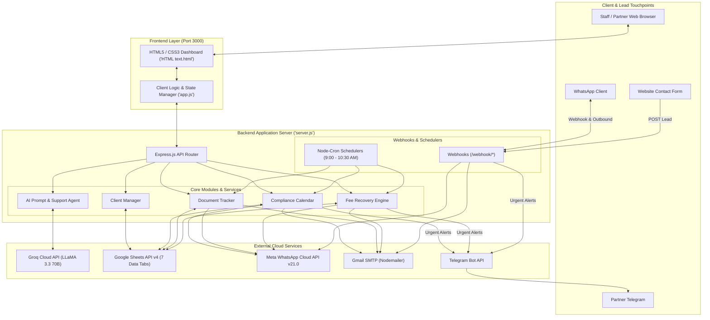
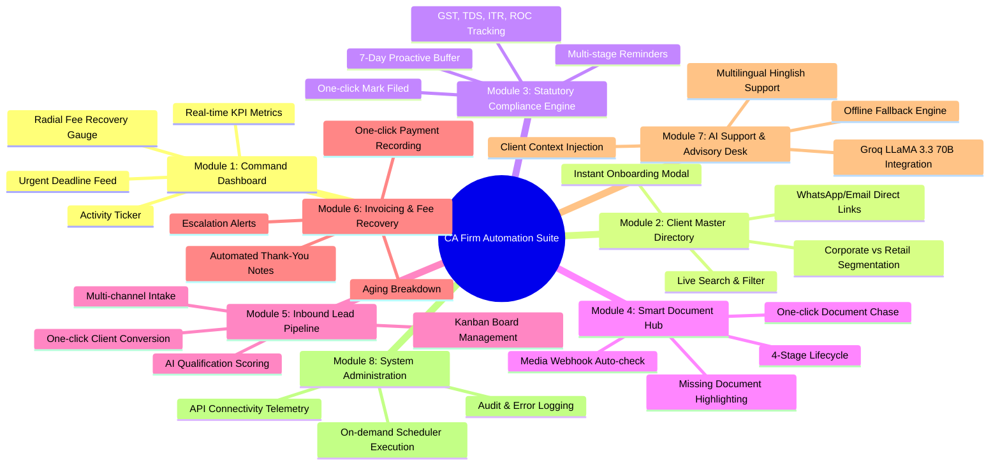
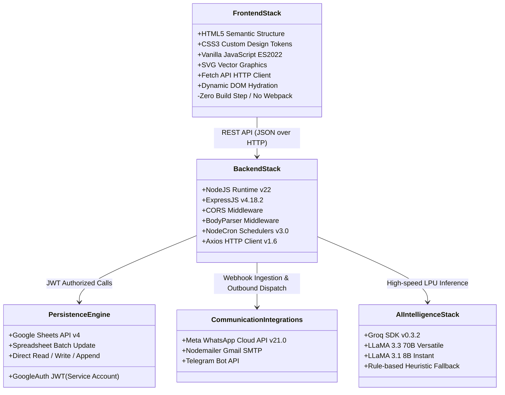
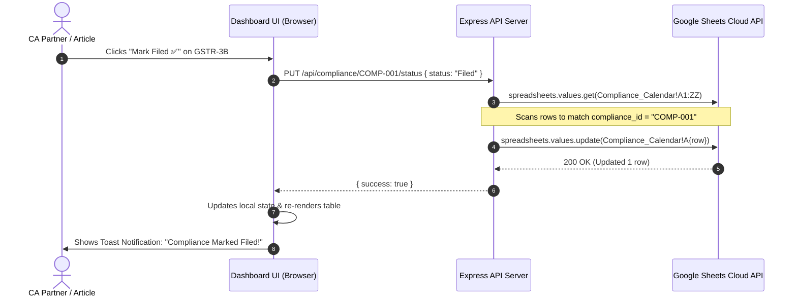
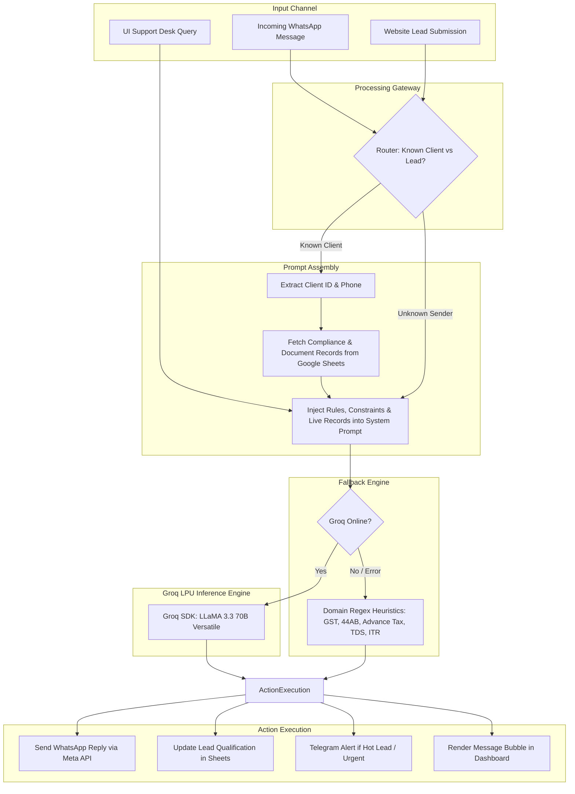
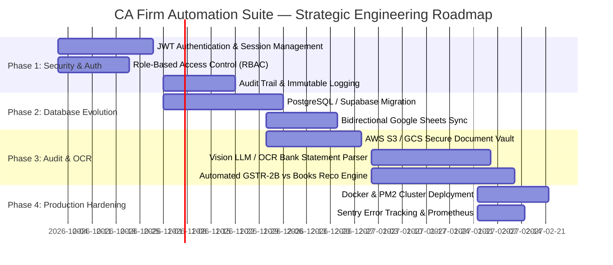

# CA Firm Automation Suite — Comprehensive SRS, Tech Stack Audit & Operational Workflow Manual

> **Document Type:** Software Requirements Specification (SRS) & Architecture Audit  
> **Target Audience:** Firm Partners, System Architects, Lead Engineers, and Practice Operations Teams  
> **Product Name:** CA Firm Automation Suite ("Sharma & Associates" Practice Edition)  
> **Version:** 1.0.0 (Enterprise Practice Release)  
> **Current Date:** September 17, 2026  
> **Repository Location:** [`CA automation/`](file:///Users/kachhadiyamanthanhareshbhai/Downloads/PROJECTS/CA%20automation)

---

## Executive Summary & System Context

The **CA Firm Automation Suite** is an integrated Practice Operating System engineered specifically for Indian Chartered Accountancy firms (ranging from sole practitioners to mid-sized firms of 1 to 15 partners and 5 to 50 article assistants/staff). 

In traditional Indian CA offices, **over 60% of billable hours** are consumed by non-billable operational drag:
1. Manually chasing clients for bank statements, GST sales/purchase registers, Form 16/26AS, and audit confirmations over phone calls and scattered WhatsApp chats.
2. Tracking dozens of overlapping statutory deadlines across multiple regulatory bodies (GSTN, Income Tax Department, MCA/ROC, and EPFO/ESIC) on offline spreadsheets.
3. Managing billing disputes, uncollected audit fees, and delayed retainer recoveries.
4. Handling repetitive client inquiries late at night and during peak filing seasons (July, September, October).

The CA Firm Automation Suite resolves this friction by deploying a **hybrid lightweight cloud architecture**:
- **Persistence Layer:** Google Sheets API v4 acting as a transparent, zero-maintenance headless relational database that partners can view and edit natively in real time.
- **Backend Application Layer:** Node.js & Express.js orchestrating business rules, cron schedules, and multi-channel communication pipelines.
- **AI Intelligence Layer:** Groq-accelerated LLaMA 3.3 70B & 3.1 8B inference engine powering conversational tax support, inbound lead qualification, and automated multilingual correspondence.
- **Client Engagement Layer:** Meta WhatsApp Cloud API, Nodemailer (Gmail SMTP), and Telegram Bot API.
- **User Interface:** A custom, high-density dashboard inspired by modern fintech command centers, providing 1-click action triggers and complete operational observability.

---



---

# PART 1: Software Requirements Specification (SRS)

## 1. Product Scope & Objectives

### 1.1 Scope
The product delivers an end-to-end automation workflow for:
- Client data onboarding and directory management.
- Statutory compliance deadline tracking with proactive countdown alerts.
- Document collection workflow with client-side status tracking and automated chases.
- Inbound lead intake, automated qualification scoring, and proposal follow-up.
- Accounts receivable, automated payment follow-ups, and fee settlement.
- 24/7 AI-powered conversational support trained on Indian tax codes.

### 1.2 User Personas & Roles

| Persona | Role in Firm | Primary Pain Point Solved | System Interactions |
| :--- | :--- | :--- | :--- |
| **Senior Partner (CA Rajesh Sharma)** | Firm leadership, audit sign-off, client advisory | Lack of centralized visibility into overdue filings, unbilled fees, and staff bottlenecks | KPI Command Dashboard, High-value invoice tracking, Telegram emergency alerts |
| **Audit & Tax Partner** | Managing statutory audits, Tax Audits (Sec 44AB), ROC filings | Missed client document submission deadlines leading to last-minute filing panics | Compliance Calendar, Document Vault verification, 1-click filing status updates |
| **Article Assistants / Paid Staff** | Ground-level execution: GST filing, TDS computation, voucher verification | 15–20 hours/week spent making phone calls asking for missing bank statements | Document verification queue, WhatsApp one-click chase triggers, Client directory |
| **Corporate / Retail Client** | Business owner, CFO, or individual taxpayer | Unclear requirements, no reminder before penalty cut-offs, delayed responses to simple tax queries | Receives automated WhatsApp nudges, submits documents via WhatsApp media, interacts with AI Support Desk |
| **Inbound Prospect** | Business seeking new incorporation, GST, or tax filing services | Delayed responses to website queries and lack of qualification | Automated WhatsApp qualification bot, automated proposal follow-ups |

---

## 2. Functional Requirements (FRS)



### FR-1: Practice Command Dashboard
- **FR-1.1:** The system shall aggregate and display real-time KPI counts: Active Clients, Pending Documents, Compliances Due within 7 days, and Overdue Fees.
- **FR-1.2:** The system shall render a dynamic SVG radial progress gauge computing the exact billing collection percentage (`(collectedFees / totalBilled) * 100`).
- **FR-1.3:** The system shall render an urgent deadline transfer feed showing the top 3 nearest statutory filing deadlines with color-coded status badges (`+Filed`, `-Overdue`, `-Urgent`, `+On track`).
- **FR-1.4:** The system shall automatically refresh dashboard telemetry every 120 seconds without page reload (`setInterval(loadAllData, 120000)` in [`app.js`](file:///Users/kachhadiyamanthanhareshbhai/Downloads/PROJECTS/CA%20automation/app.js#L1290)).

### FR-2: Client Master Directory & Onboarding
- **FR-2.1:** The system shall maintain client profiles including `client_id`, `name`, `phone`, `email`, and `created_at` in the Google Sheet `Clients` tab.
- **FR-2.2:** The system shall provide an Onboarding Modal allowing instant addition of new clients. Upon submission, it must generate a sequential client ID (`CLIENT-001`, `CLIENT-002`, etc.) and append the record via Google Sheets API v4.
- **FR-2.3:** The UI shall allow real-time full-text search and filtering across clients by entity type (Corporate: Pvt Ltd/LLP vs Retail: Proprietorship/Individual), missing documents, and outstanding dues.

### FR-3: Statutory Compliance Calendar & Penalty Engine
- **FR-3.1:** The system shall track compliance items categorized by regulatory body:
  - **GSTN:** GSTR-1 (11th monthly), GSTR-3B (20th monthly), GSTR-9 (Annual).
  - **Direct Tax:** TDS Challan 281 (7th monthly), TDS Quarterly Returns 24Q/26Q, Advance Tax installments (15 Jun, 15 Sep, 15 Dec, 15 Mar), ITR Non-Audit (31 Jul), Tax Audit Sec 44AB (30 Sep), ITR Corporate/Audit (31 Oct).
  - **MCA / ROC:** AOC-4 Financials (30 Oct), MGT-7 Annual Return (29 Nov).
- **FR-3.2:** The system shall calculate days until due dynamically (`daysFromToday(due_date)`) and categorize urgency:
  - `days < 0`: 🚨 **Overdue** (displays exact days overdue and statutory penalty risks: ₹50/day GST, 1.5%/month TDS interest, ₹5,000 Sec 234F).
  - `0 <= days <= 3`: ⚠️ **Urgent**.
  - `4 <= days <= 7`: ⏳ **Warning**.
  - `days > 7`: ✓ **On Track**.
- **FR-3.3:** The system shall provide a `Mark Filed ✅` action button that updates the Google Sheet row status to `Filed` via `PUT /api/compliance/:complianceId/status`.

### FR-4: Smart Document Collection & Verification Hub
- **FR-4.1:** The system shall track required documents per client across a 4-stage lifecycle: `Pending` &rarr; `Received` &rarr; `Verified` &rarr; `Rejected`.
- **FR-4.2:** Documents shall be grouped by client in the UI, displaying an individual progress bar (`received / total * 100%`) and highlighting missing files.
- **FR-4.3:** Clicking `+ Mark Done` on a pending document must issue `PUT /api/documents/:docId/mark-received`, recording the `received_date` timestamp in ISO 8601 format.
- **FR-4.4:** Incoming media sent by known clients via WhatsApp shall be captured by the WhatsApp webhook, automatically matching pending documents and advancing their status to `Received`.

### FR-5: Inbound Lead Acquisition & AI Qualification
- **FR-5.1:** The system shall ingest leads from multiple sources: Webhook form submissions (`POST /webhook/website-lead`) and unsolicited WhatsApp messages (`POST /webhook/whatsapp`).
- **FR-5.2:** Inbound inquiries shall be analyzed using Groq AI (`classifyToJSON`) to automatically extract:
  - `requirement`: GST Registration, ITR Filing, Company Incorporation, Tax Audit, Bookkeeping, ROC Compliance, etc.
  - `business_type`: Individual, Proprietorship, Partnership, Company.
  - `urgency`: High, Medium, Low.
  - `qualification_score`: Hot, Warm, Cold.
- **FR-5.3:** The UI shall display a 4-column Kanban board (`New` &rarr; `Qualifying` &rarr; `Proposal Sent` &rarr; `Converted`).
- **FR-5.4:** Advancing a lead to `Converted` automatically qualifies them for onboarding into the master client directory.
- **FR-5.5:** Leads classified as `Hot` or `High` urgency shall immediately trigger an alert to the Senior Partner's Telegram handle.

### FR-6: Invoicing & Automated Fee Recovery Engine
- **FR-6.1:** The system shall track invoices with fields: `invoice_id`, `client_id`, `client_name`, `amount`, `currency`, `due_date`, `status`, `reminder_count`, `last_reminder_date`, `escalated`.
- **FR-6.2:** Invoices shall be subjected to aging analysis:
  - `upcoming_3d`: 3 days before due date (gentle reminder).
  - `due_today`: Due date (payment instructions).
  - `overdue_mild`: 1–7 days overdue.
  - `overdue_moderate`: 8–15 days overdue.
  - `overdue_severe`: >15 days overdue (flags `escalated: Yes` and alerts partner via Telegram).
- **FR-6.3:** The system shall allow 1-click manual dispatch of WhatsApp and Email reminders directly from the UI table rows.
- **FR-6.4:** When an invoice is paid, clicking `Paid ✅` updates the status to `Paid`, updates the radial gauge calculation, and triggers an automated AI thank-you note.

### FR-7: 24/7 AI Client Support & Advisory Desk
- **FR-7.1:** The system shall provide an interactive chat interface in the dashboard connecting to `POST /api/ai/chat`.
- **FR-7.2:** The AI agent shall be instructed with comprehensive Indian tax laws, filing due dates, and client-specific context dynamically injected from Google Sheets.
- **FR-7.3:** The AI shall support code-switching in English and conversational Hinglish matching the client's language.
- **FR-7.4:** The agent shall enforce strict guardrails: never quote fee amounts, never invent unverified filing dates, and never expose data belonging to other clients.
- **FR-7.5:** If the Groq API fails or is unreachable, the system shall execute an internal heuristic regex fallback engine (`getSmartFallbackReply`) answering statutory questions seamlessly.

### FR-8: System Administration & Schedulers Hub
- **FR-8.1:** The system shall expose 4 daily cron jobs running in Node.js:
  - `09:00 AM`: Compliance Deadline Reminders (`complianceReminder.js`).
  - `09:30 AM`: Document Follow-ups (`documentFollowup.js`).
  - `10:00 AM`: Lead Proposal Follow-ups (`leadFollowup.js`).
  - `10:30 AM`: Overdue Fee Reminders (`invoiceFollowup.js`).
- **FR-8.2:** The Settings view shall display live health telemetry for WhatsApp Cloud API, Google Sheets API, Groq AI, and Email SMTP.
- **FR-8.3:** The system shall provide manual "Run Now" triggers in the UI to execute any scheduler on demand for demonstration and audit purposes.

---

## 3. Non-Functional Requirements (NFRs)

| NFR Category | Requirement Specification | Current Implementation Status |
| :--- | :--- | :--- |
| **NFR-1: Performance & Latency** | Dashboard page load under 1.5s; AI chat response latency under 1200ms using Groq LPU inference. | Achieved via Groq SDK (`groq-sdk`) and pure vanilla DOM rendering. |
| **NFR-2: Scalability** | Support up to 500 active clients and 5,000 monthly transactions on Google Sheets backend. | Currently verified up to 50 clients (`seed-50-clients.js`). Google Sheets quota limits rate to 300 read/min. |
| **NFR-3: Data Integrity & Reliability** | All write operations to Google Sheets must verify header alignment before appending or updating rows. | Enforced in [`sheetsService.js`](file:///Users/kachhadiyamanthanhareshbhai/Downloads/PROJECTS/CA%20automation/backend/services/sheetsService.js#L73-L75). |
| **NFR-4: Error Handling & Auditing** | Any failure in webhooks, schedulers, or APIs must be logged to the `Error_Log` tab and forwarded to Telegram. | Implemented in [`errorHandler.js`](file:///Users/kachhadiyamanthanhareshbhai/Downloads/PROJECTS/CA%20automation/backend/utils/errorHandler.js#L8-L26). |
| **NFR-5: Security & Privacy** | Private keys and API tokens must never be exposed to the client-side bundle. Service account keys stored in server `.env`. | Enforced via server-side encapsulation; frontend communicates strictly via Express proxy. |
| **NFR-6: Fault Tolerance** | AI support must continue functioning even during total external LLM outage. | Smart CA Fallback engine implemented in [`aiRoutes.js`](file:///Users/kachhadiyamanthanhareshbhai/Downloads/PROJECTS/CA%20automation/backend/routes/aiRoutes.js#L23-L44). |

---

## 4. Complete Data Dictionary (Google Sheets Schema)

The database engine relies on a single Google Spreadsheet defined by `GOOGLE_SHEET_ID`, organized into 7 distinct functional tabs initialized via [`setup-sheets.js`](file:///Users/kachhadiyamanthanhareshbhai/Downloads/PROJECTS/CA%20automation/backend/setup-sheets.js):

### 4.1 Tab: `Clients`
| Column Name | Data Type | Constraints / Format | Description |
| :--- | :--- | :--- | :--- |
| `client_id` | String (PK) | `CLIENT-XXX` (Unique) | Unique identifier for the client entity |
| `name` | String | Not Null | Registered company or individual name |
| `phone` | String | Digits only (`91XXXXXXXXXX`) | WhatsApp-enabled phone number |
| `email` | String | Valid RFC 5322 Email | Official email address for billing/compliance |
| `created_at` | Timestamp | ISO 8601 UTC | Timestamp of initial onboarding |

### 4.2 Tab: `Leads`
| Column Name | Data Type | Constraints / Format | Description |
| :--- | :--- | :--- | :--- |
| `lead_id` | String (PK) | `LEAD-WA-XXX` / `LEAD-WEB-XXX` | Unique inbound lead identifier |
| `name` | String | Text | Contact person or business name |
| `phone` | String | Digits only | Primary phone number |
| `email` | String | Email string | Lead email address |
| `source` | Enum | `WhatsApp`, `Website`, `Referral` | Acquisition channel |
| `requirement` | String | Tax/Compliance domain | Inquired service (e.g., "GST Registration") |
| `business_type` | Enum | `Individual`, `Proprietorship`, `Partnership`, `Company` | Legal structure of the lead |
| `urgency` | Enum | `High`, `Medium`, `Low`, `Unclear` | Urgency determined by AI |
| `qualification_score`| Enum | `Hot`, `Warm`, `Cold` | Lead scoring metric |
| `status` | Enum | `New`, `Qualifying`, `Proposal Sent`, `Converted`, `Lost`, `Cold-Closed` | Pipeline stage |
| `followup_date` | Date | `YYYY-MM-DD` | Next scheduled follow-up date |
| `followup_attempts`| Integer | Default: 0, Max: 4 | Count of automated follow-ups sent |
| `created_at` | Timestamp | ISO 8601 | Intake timestamp |
| `notes` | String | Text | Original inquiry text or partner notes |

### 4.3 Tab: `Compliance_Calendar`
| Column Name | Data Type | Constraints / Format | Description |
| :--- | :--- | :--- | :--- |
| `compliance_id` | String (PK) | `COMP-XXX` | Unique compliance schedule record |
| `client_id` | String (FK) | References `Clients.client_id` | Target client |
| `client_name` | String | Denormalized | Cached client name for fast rendering |
| `phone` | String | Digits only | Client phone number |
| `email` | String | Email string | Client email |
| `compliance_type` | String | Statutory form code | `GSTR-3B`, `GSTR-1`, `TDS 26Q`, `ITR-6`, `AOC-4`, etc. |
| `due_date` | Date | `YYYY-MM-DD` | Government statutory cut-off deadline |
| `status` | Enum | `Pending`, `Filed`, `Overdue` | Filing status |
| `reminder_count` | Integer | Numeric counter | Number of reminders dispatched |
| `last_reminder_date`| Timestamp| ISO 8601 | Timestamp of latest automated reminder |

### 4.4 Tab: `Documents_Tracker`
| Column Name | Data Type | Constraints / Format | Description |
| :--- | :--- | :--- | :--- |
| `doc_id` | String (PK) | `DOC-XXX` | Unique document request identifier |
| `client_id` | String (FK) | References `Clients.client_id` | Target client |
| `client_name` | String | Denormalized | Client name |
| `phone` | String | Digits only | Client phone |
| `email` | String | Email string | Client email |
| `compliance_type` | String | Domain tag | Associated filing (e.g. `Tax Audit 44AB`) |
| `document_name` | String | Text | Required file name (e.g., "Bank Statement", "Form 16") |
| `requested_date` | Timestamp | ISO 8601 | Initial request date |
| `status` | Enum | `Pending`, `Received`, `Verified`, `Rejected` | Verification stage |
| `received_date` | Timestamp | ISO 8601 | Date received from client |
| `followup_count` | Integer | Numeric counter | Chases sent |
| `last_followup_date`| Timestamp| ISO 8601 | Date of latest follow-up |

### 4.5 Tab: `Invoices`
| Column Name | Data Type | Constraints / Format | Description |
| :--- | :--- | :--- | :--- |
| `invoice_id` | String (PK) | `INV-XXX` | Unique invoice number |
| `client_id` | String (FK) | References `Clients.client_id` | Billed client |
| `client_name` | String | Denormalized | Client name |
| `phone` | String | Digits only | Client phone |
| `email` | String | Email string | Client email |
| `amount` | Float/String | Numeric string (e.g., "25000") | Bill amount in INR |
| `currency` | String | Default: `INR` | Billing currency |
| `due_date` | Date | `YYYY-MM-DD` | Payment due date |
| `status` | Enum | `Unpaid`, `Paid`, `Overdue` | Payment state |
| `reminder_count` | Integer | Numeric counter | Payment nudges sent |
| `last_reminder_date`| Timestamp| ISO 8601 | Date of latest reminder |
| `escalated` | Enum | `Yes`, `No` | Flagged if overdue > 15 days |

### 4.6 Tab: `Query_Log`
| Column Name | Data Type | Description |
| :--- | :--- | :--- |
| `log_id` | String (PK) | Unique log ID (`LOG-TIMESTAMP-XXX`) |
| `client_id` | String | Identifier of client (if recognized) |
| `phone` | String | Phone number of sender |
| `email` | String | Email address of sender |
| `channel` | Enum | `whatsapp`, `email`, `web_chat` |
| `query_text` | Text | Full client inquiry |
| `ai_response` | Text | Generated LLM response |
| `timestamp` | Timestamp | Time recorded |

### 4.7 Tab: `Error_Log`
| Column Name | Data Type | Description |
| :--- | :--- | :--- |
| `error_id` | String (PK) | Unique error ID (`ERR-TIMESTAMP-XXX`) |
| `workflow_name` | String | Module where error occurred |
| `node_name` | String | Function or endpoint identifier |
| `error_message` | Text | Truncated error stack/message |
| `timestamp` | Timestamp | Time of failure |

---

# PART 2: Comprehensive Tech Stack Analysis



## 1. Frontend Architecture Deep-Dive
- **Zero-Build Vanilla Architecture:**
  - Files: [`HTML text.html`](file:///Users/kachhadiyamanthanhareshbhai/Downloads/PROJECTS/CA%20automation/HTML%20text.html) (2,731 lines) and [`app.js`](file:///Users/kachhadiyamanthanhareshbhai/Downloads/PROJECTS/CA%20automation/app.js) (1,311 lines).
  - Designed without bundlers (Vite, Webpack) or heavy frameworks (React, Angular, Vue). This allows the application to be launched instantly on any local or remote machine with zero compilation latency.
- **Design System & Visual Language:**
  - Bespoke color palette tailored for executive accounting:
    - `--bg-canvas`: `#EBE9E4` (Warm limestone/oyster tone reducing eye strain).
    - `--dark-green`: `#3B5244` (Deep forest green representing financial stability).
    - `--gold-coin`: `#F4EDE0` / `#B38D4F` (Sophisticated gold accents for high-value metrics).
    - `--card-bg`: `#FFFFFF` with soft diffused shadows (`box-shadow: 0 8px 30px -4px rgba(0,0,0,0.04)`).
  - Typography: Google Font `Plus Jakarta Sans` across weights 400 to 800.
- **State Management:**
  - Global reactive client state maintained in `app.js`:
    ```javascript
    const state = {
      clients: [],
      leads: [],
      compliance: [],
      documents: [],
      invoices: [],
      stats: {},
      currentView: 'dashboard',
      lastRefresh: null,
    };
    ```
  - View controller: `switchView(viewId, el)` activates panels (`view-dashboard`, `view-agent`, `view-documents`, `view-compliance`, `view-leads`, `view-invoices`, `view-clients`, `view-settings`) and re-triggers view-specific data rendering.
- **Data Visualization & Canvas/SVG Math:**
  - The radial recovery gauge computes semicircular SVG arc geometry dynamically:
    $$\theta = \left(\frac{\text{collected}}{\text{total}}\right) \times \pi$$
    $$X = 80 - 65 \cos(\theta), \quad Y = 85 - 65 \sin(\theta)$$
    $$\text{path} = \text{"M 15 85 A 65 65 0 0 1 } X \text{ } Y\text{"}$$

---

## 2. Backend Architecture Deep-Dive
- **Express.js Server Core ([`server.js`](file:///Users/kachhadiyamanthanhareshbhai/Downloads/PROJECTS/CA%20automation/backend/server.js)):**
  - Configured with `cors` allowing cross-origin requests from the dashboard and local developer tools.
  - Serves static assets from root directory, routing `/` directly to `HTML text.html`.
  - Exposes health monitoring at `/health`.
- **Modular Routing Architecture:**
  - `/api/dashboard`: Aggregated stats (`/stats`) and priority upcoming deadlines (`/upcoming-deadlines`).
  - `/api/clients`: Client directory retrieval and new client creation.
  - `/api/leads`: Lead retrieval and pipeline status transitions (`PUT /:leadId/status`).
  - `/api/compliance`: Compliance listing and status updates (`PUT /:complianceId/status`).
  - `/api/documents`: Document tracker and mark-received transitions (`PUT /:docId/mark-received`).
  - `/api/invoices`: Billing records, status updates, and manual reminder dispatches.
  - `/api/ai`: Live interactive chat endpoint (`POST /chat`).
- **Webhook Gateway Layer:**
  - `/webhook/whatsapp`: Handles Meta webhook challenge verification (GET) and incoming WhatsApp text/document events (POST).
  - `/webhook/website-lead`: Ingests contact forms from prospective clients.
  - `/webhook/payment`: Receives payment confirmation events from gateways.
  - `/webhook/request-documents`: Programmatic endpoint for batch document requests.
- **Scheduler Engine (`node-cron`):**
  - Runs in-process cron jobs configured on 24-hour schedules with timezone awareness.

---

## 3. Persistence Engine: Google Sheets as Headless Database

### Architectural Justification
Chartered Accountants live in spreadsheets. Using Google Sheets API v4 as the primary database provides an unprecedented operational advantage: **the CA firm partner can open the spreadsheet on Google Drive on their phone or tablet, make manual corrections, add notes, or inspect records, and the web platform reflects those changes immediately upon the next fetch cycle.**



### Trade-Off Analysis
| Capability | Google Sheets API v4 | Relational DB (PostgreSQL) | Current Mitigation in Suite |
| :--- | :--- | :--- | :--- |
| **Human Accessibility** | 10/10 (Familiar Excel/Sheets UI) | 2/10 (Requires pgAdmin / SQL) | Primary feature for non-technical CA staff. |
| **Cost** | Free (Google Cloud Free Tier) | \$15–\$50/month hosted | Zero ongoing database hosting cost. |
| **Transaction ACID Guarantees** | None (Risk of race conditions on parallel updates) | Full ACID compliance | Low concurrency in 1–15 partner firms; row-level matching by key column. |
| **Query Latency** | 300ms – 1100ms per batch call | 2ms – 15ms | Cached in frontend `state`, parallelized via `Promise.all()`. |
| **Rate Limits** | 300 read requests / min | Virtually unlimited | Dashboard polls every 2 minutes; avoids throttling. |

---

# PART 3: AI Integrations & LLM Architecture



## 1. Groq Inference Engine & Models
- **Provider:** Groq Cloud API via official Node.js SDK (`groq-sdk`).
- **Hardware Acceleration:** Groq LPU (Language Processing Unit), delivering generation speeds exceeding **250–300 tokens/second**, enabling near-instantaneous client interactions.
- **Model Selection:**
  - Primary: `llama-3.3-70b-versatile` (specified in [`keys.js`](file:///Users/kachhadiyamanthanhareshbhai/Downloads/PROJECTS/CA%20automation/backend/config/keys.js#L13)).
  - Production Alternative: `llama-3.1-8b-instant` (specified in [`.env`](file:///Users/kachhadiyamanthanhareshbhai/Downloads/PROJECTS/CA%20automation/backend/.env#L12)), balancing cost and sub-second response times for high-volume WhatsApp traffic.

---

## 2. Dynamic Context Injection Architecture
In [`supportAgent.js`](file:///Users/kachhadiyamanthanhareshbhai/Downloads/PROJECTS/CA%20automation/backend/ai/supportAgent.js), the support system does **not** rely on generic, hallucination-prone static prompts. When a message is received from a client, the backend dynamically synthesizes live records from Google Sheets into the system prompt:

```javascript
// Build live context from sheets
const [complianceRows, docRows] = await Promise.all([
  Compliance.getAll(),
  Documents.getAll(),
]);

const clientCompliance = complianceRows.filter((r) => r.client_id === client.client_id);
const clientDocs       = docRows.filter((r) => r.client_id === client.client_id);

const complianceLines = clientCompliance.length
  ? clientCompliance.map((r) => `- ${r.compliance_type}: due ${r.due_date}, status ${r.status}`).join('\n')
  : '- No compliance records on file.';

const docLines = clientDocs.length
  ? clientDocs.map((r) => `- ${r.document_name} (${r.compliance_type}): ${r.status}`).join('\n')
  : '- No documents currently requested.';
```

### Injected System Prompt Structure:
```text
You are the AI support assistant for Sharma & Associates, a Chartered Accountancy firm in India. Today is 17 Sep 2026.
Client: Mehta Textiles Pvt Ltd (Client ID: CLIENT-001).

Client's compliance calendar:
- GSTR-3B (August 2026): due 2026-09-20, status Pending
- Tax Audit Sec 44AB: due 2026-09-30, status Pending

Client's document status:
- Monthly Bank Statement (GSTR-3B): Pending
- Purchase Register (GSTR-3B): Received

Rules:
- Answer questions about GST, ITR, TDS, ROC, and general tax/compliance in simple, clear language.
- Hindi-English mix is fine if the client writes that way.
- Use the compliance/document data above to answer specifics about THIS client's due dates and pending documents.
- Never invent a due date or document status not listed above.
- For anything requiring judgment or you are not fully certain about, tell the client a CA from the team will personally follow up.
- Keep replies short and WhatsApp-appropriate (2-4 lines max).
- Never share other clients' data.
```

---

## 3. Intelligent Fallback Engine ([`aiRoutes.js`](file:///Users/kachhadiyamanthanhareshbhai/Downloads/PROJECTS/CA%20automation/backend/routes/aiRoutes.js))
To safeguard the firm's reputation against API downtime, quota exhaustion, or missing environment variables, the platform incorporates a deterministic, domain-specific rule engine (`getSmartFallbackReply(query)`):

```javascript
function getSmartFallbackReply(query) {
  const q = (query || '').toLowerCase();
  if (q.includes('gstr') || q.includes('gst')) {
    return '🙏 Namaste! August 2026 ke GSTR-3B ki due date 20 September 2026 hai aur GSTR-1 ki 11 September 2026 thi. Kripya apna monthly bank statement aur sales invoice register is WhatsApp number par PDF format mein share kar dein taaki filing samay par ho sake.';
  }
  if (q.includes('audit') || q.includes('44ab')) {
    return 'Tax Audit Section 44AB ke antargat financial year 2025-26 (AY 2026-27) ki audit report file karne ki statutory deadline 30 September 2026 hai. Kripya audited balance sheet, P&L, aur bank confirmation letters jald bhej dein.';
  }
  // Handles advance tax, ITR, TDS, and invoices...
}
```

---

## 4. Multi-Stage Automated Drafting Engine ([`draftMessages.js`](file:///Users/kachhadiyamanthanhareshbhai/Downloads/PROJECTS/CA%20automation/backend/ai/draftMessages.js))
Rather than sending robotic, pre-baked messages, the platform calls Groq AI to draft contextual, empathetic, yet legally precise communications across 7 distinct operational events:

1. **Compliance Reminder:** Adapts tone based on stage:
   - `friendly_7d`: Gentle heads-up 7 days prior.
   - `reminder_3d`: Clear checklist reminder 3 days prior.
   - `urgent_1d`: High-priority alert 24 hours prior.
   - `due_today`: Action-now reminder specifying portal cutoff hours.
   - `overdue`: Polite but firm notice highlighting Section 47 / 234E late fees and interest liability.
2. **Document Request & Follow-Up:** Progressive follow-up numbering (`followup_count + 1`) that turns firmer on the 3rd chase.
3. **Lead Follow-Up:** Polite check-in without aggressive sales language or unsolicited fee quotes.
4. **Invoice Collection Reminder:** Progressive severity: `upcoming_3d` &rarr; `due_today` &rarr; `overdue_mild` &rarr; `overdue_moderate` &rarr; `overdue_severe` (>15 days overdue, announcing partner escalation).
5. **Payment Acknowledgment:** Immediate warm gratitude message confirming invoice closure.

---

# PART 4: End-to-End UI & Operational Workflow Manual

This section outlines the exact operational procedures for how CA firm partners, article assistants, and external clients interact with the suite throughout a business cycle.

```mermaid
journey
    title A Day in the Life: Operational Workflow Journey
    section Morning Standup (9:00 - 10:30 AM)
      Cron triggers 9:00 AM compliance check: 5: System
      Cron triggers 9:30 AM doc follow-up: 5: System
      Cron triggers 10:30 AM fee reminders: 5: System
      Senior Partner opens Practice Dashboard: 5: Partner
      Reviews 4 KPI cards & Radial Gauge: 5: Partner
    section Midday Audit & Filing (11:00 AM - 4:00 PM)
      Article checks Document Vault for missing files: 4: Article
      Client sends bank statement on WhatsApp: 5: Client
      Webhook receives PDF & marks status 'Received': 5: System
      Article verifies statements & files GSTR-3B: 4: Article
      Article clicks 'Mark Filed ✅' on dashboard: 5: Article
    section Evening Review & Client Inquiries (5:00 PM - 11:00 PM)
      Client asks tax question on WhatsApp at 10 PM: 5: Client
      Groq AI answers in 1.5s in Hinglish: 5: System
      Query logged in Query_Log: 5: System
      Partner receives daily Telegram summary: 5: Partner
```

---

## 1. Step-by-Step UI Module Workflows

### Workflow 1: Morning Practice Standup & Bottleneck Identification
1. **Login & Overview:** The Senior Partner accesses `http://localhost:3000/`. The system immediately checks backend API health (indicated by the pulsing green dot in the header: `API Live`).
2. **KPI Evaluation:**
   - Evaluates **Active Clients** (total count of corporate and individual accounts).
   - Inspects **Pending Documents** (e.g., 6 missing files blocking tax audits).
   - Assesses **Compliances Due** (e.g., 3 filings due in under 72 hours).
   - Reviews **Overdue Fees** (e.g., ₹42,500 uncollected).
3. **Recovery Gauge Check:** Reviews the radial gauge to observe monthly cash recovery progression against billing targets.
4. **Urgent Filing Review:** Scans the `Upcoming Deadlines` transfer card to identify which clients have not provided sign-offs for upcoming cut-offs.

### Workflow 2: Managing Statutory Audits & Compliance Deadlines
1. Click the **Compliance Tracker** icon in the capsule sidebar (`switchView('compliance')`).
2. **Filter Deadlines:** Filter filings by authority: `All`, `GST Only`, `Income Tax`, `ROC/MCA`.
3. **Countdown Prioritization:** Filings are color-coded:
   - Items with red tags (`🚨 2d Overdue!` or `⚠️ Due in 1d`) appear at the top.
4. **Action Execution:**
   - Click `📱 WhatsApp Remind` to dispatch an instant personalized nudge to the client's registered mobile number.
   - Once the return or audit report is uploaded to the portal, the article clicks `Mark Filed ✅`.
   - The UI immediately swaps the badge to `+Filed` and updates Google Sheets in the background.

### Workflow 3: Document Collection & Verification Pipeline
1. Navigate to the **Document Vault** (`switchView('documents')`).
2. **Review Client Cards:** Each corporate entity has a dedicated card showing submission progress (e.g., `Mehta Textiles Pvt Ltd: 50% Completed - 1 Doc Missing`).
3. **Review Document States:**
   - Documents with a green checkmark `✓` indicate files marked `Verified` or `Received`.
   - Documents with a red border `📄` indicate missing items (e.g., "Monthly Bank Statement").
4. **Receiving Documents:**
   - **Automated Mode:** When the client sends an image or PDF to the firm's WhatsApp number, the webhook matches their phone number and marks the pending file as `Received`.
   - **Manual Mode:** If a client drops off physical hard copies or emails the partner, the article clicks `+ Mark Done` next to the document item.
5. **Mass Chases:** If 3 files are pending 4 days before an audit deadline, clicking `📱 WhatsApp Chase` compiles the exact list of missing items and sends a consolidated WhatsApp message.

### Workflow 4: Client Acquisition & Lead Pipeline Management
1. Open the **Client Acquisition** panel (`switchView('leads')`).
2. View the 4-stage visual Kanban board:
   - **New (Inbound):** Fresh leads captured from website forms or new WhatsApp inquiries.
   - **Qualifying:** AI is actively chatting with the lead to determine business type and budget.
   - **Proposal Sent:** Quotation sent by the partner.
   - **Converted (Won):** Client has agreed to retain the firm.
3. **AI Score & Summary:** Inspect the AI summary badge on lead cards (e.g., `🤖 Needs new GSTIN for upcoming Amazon seller launch within 5 days | Score: 90% Hot`).
4. **Stage Progression:**
   - Click `📱 WA` to initiate a 1-on-1 WhatsApp chat with the lead.
   - Click `Advance Stage →` to move the lead card from `Qualifying` to `Proposal Sent`.
   - When won, click `Convert to Client 🎉` to automatically create a master client account in Google Sheets.

### Workflow 5: Fee Recovery & Billing Enforcement
1. Navigate to **Billing & Fees** (`switchView('invoices')`).
2. **Assess Receivables:** Check top metric tiles: Total Billed (`₹3,65,000`), Collected Fees (`₹1,37,000`), and Outstanding Dues (`₹2,28,000`).
3. **Filter Overdue Accounts:** Click the `Overdue Bills` pill filter.
4. **Nudge Clients:**
   - Click `📱 WA` to send an automated payment link with invoice reference.
   - Click `📧` to dispatch a formal email invoice reminder.
5. **Record Payment:** Upon receiving payment confirmation via bank NEFT or UPI, click `Paid ✅`. The invoice is stamped as `✓ Settled` and the dashboard revenue charts update in real time.

### Workflow 6: 24/7 AI Client Desk Interaction
1. Navigate to **AI Client Desk** (`switchView('agent')`).
2. **Interactive Testing & Support:** Articles and partners can query the assistant regarding complex filing scenarios:
   - *"Client is asking: What is the turnover limit for Tax Audit under Section 44AB for digital transactions?"*
   - Groq AI responds in under 2 seconds: *"Under Section 44AB, the turnover limit is ₹10 Crores provided cash transactions do not exceed 5% of total turnover. Otherwise, the standard limit is ₹1 Crore."*
3. **WhatsApp Auto-Pilot:** External clients texting the firm's WhatsApp number receive these contextual responses automatically 24/7.

---

# PART 5: Audit Suitability & Strategic Improvisation Roadmap

While the current architecture provides immense operational leverage, deploying this software in high-volume, regulated statutory audit environments requires addressing critical gaps in data governance, security, and scalability.



---

## 1. Audit Suitability Gap Analysis

| Dimension | Current Implementation | Statutory Audit / ICAI Requirement | Risk Level | Recommended Improvisation |
| :--- | :--- | :--- | :--- | :--- |
| **Authentication & Access Control** | Open dashboard accessible to anyone with network URL access. | Standard on Auditing (SA 230): Work papers must be protected from unauthorized tampering. | 🔴 High | Implement JWT authentication with role separation: `Senior Partner`, `Audit Manager`, `Article Assistant`, `Client`. |
| **Audit Trails & Versioning** | Google Sheets rows overwritten directly via `spreadsheets.values.update`. | Companies Act 2013 Sec 143(3) / ICAI rules: Accounting & audit software must maintain immutable audit trail logs. | 🔴 High | Implement append-only changelogs recording: `modified_by`, `old_value`, `new_value`, `ip_address`, `timestamp`. |
| **Document Storage Security** | Relies on Google Sheets tracking metadata; files stored in ad-hoc WhatsApp media. | Bank statements, PAN, and confidential P&L must be encrypted at rest (AES-256). | 🔴 High | Introduce AWS S3 / Cloudflare R2 bucket with client-specific encrypted prefixes and pre-signed view URLs. |
| **Database Concurrency** | In-memory row scanning in Google Sheets (`A1:ZZ`). | High-volume filing days (31 July, 30 September) risk write conflicts and rate limiting. | 🟡 Medium | Migrate primary OLTP to PostgreSQL/Supabase; use Google Sheets as a synchronized read-replica. |
| **Automated Tax Reconciliation** | Manual document verification status (`Pending` &rarr; `Received`). | Verification of GSTR-2B vs Purchase Register requires invoice-by-invoice reconciliation. | 🟡 Medium | Deploy OCR/VLM pipeline to extract invoice items and auto-flag ITC mismatches. |

---

## 2. Priority Architectural Improvisations

### Improvisation 1: PostgreSQL Migration with Bidirectional Google Sheets Sync
- **The Strategy:** To preserve the beloved Google Sheets interface for partners while guaranteeing enterprise-grade ACID integrity, migrate the primary database to PostgreSQL using an asynchronous bidirectional synchronization worker.
- **Architecture:**
  ```text
  [Web / WhatsApp Webhooks] 
              │
              ▼
    [PostgreSQL Database] (Source of Truth with Row-Level Locking & Foreign Keys)
              │
         (CDC Worker)
              ▼
    [Google Sheets API]   (Mirrored replica for Partner mobile viewing)
  ```

### Improvisation 2: Enterprise Role-Based Access Control (RBAC)
Define explicit permissions across 4 tiers:
1. **Managing Partner:** Full access: billing rates, bank details, profit sharing, Telegram escalations, audit sign-offs.
2. **Audit Manager / Senior CA:** Manage clients, assign staff, review and approve work papers, issue fee invoices.
3. **Article Assistant:** Read assigned clients only; upload and verify documents; mark filings as filed; no access to firm financials.
4. **Client Portal Access:** Secure Magic Link authentication via WhatsApp allowing clients to view their compliance calendar and drag-and-drop tax files directly.

### Improvisation 3: AI-Powered OCR & Auto-Reconciliation Engine
- **Current Limitation:** When a client uploads a bank statement or purchase bill on WhatsApp, the system marks the document status as `Received`, but a human article assistant must still manually review the PDF.
- **Upgraded Solution:**
  1. Ingest PDF/image via WhatsApp media API.
  2. Pass document to a Vision-Language Model (Groq LLaMA 3.2 Vision or Claude 3.5 Sonnet).
  3. Extract structured JSON: Supplier GSTIN, Invoice Date, Taxable Value, CGST, SGST, IGST.
  4. Compare automatically against the client's GSTR-2B portal dump and flag discrepancies in input tax credit (ITC) in real time.

### Improvisation 4: Audit Working Papers & Checklist Module (CARO 2020 / Sec 44AB)
Expand the compliance engine to incorporate standard ICAI audit checklists:
- **Tax Audit Checklist:** 44AB clauses (depreciation calculation, 40A(3) cash payments > ₹10,000, 43B statutory dues payment proofs).
- **Statutory Audit Checklist:** CARO 2020 verification matrices (physical inventory verification, fixed asset register verification, unrecorded loans).
- Articles complete checklists digitally, and the system archives signed working paper bundles ready for peer review.

---

## 3. Summary of Deliverables & Project Directory Index

The complete project structure verified in this audit comprises:

```text
CA automation/
├── HTML text.html                           # Master Frontend Dashboard (2,731 lines)
├── app.js                                   # Frontend State Manager & Live Connector (1,311 lines)
├── feature_guide_printable.html             # Practice Operations Manual & Sales Guide
├── CA_Firm_Automation_Feature_Guide.pdf     # Distributed PDF Reference Documentation
└── backend/
    ├── server.js                            # Express.js HTTP & Webhook Application Entry Point
    ├── package.json                         # Node.js Dependencies & Script Manifest
    ├── .env                                 # Configuration & Secrets Vault
    ├── ai/
    │   ├── draftMessages.js                 # Contextual AI Drafting Engine (7 Templates)
    │   ├── leadQualifier.js                 # Inbound Conversational Lead Classifier
    │   └── supportAgent.js                  # 24/7 Support Agent with Context Injection
    ├── config/
    │   └── keys.js                          # Validated Configuration Loader
    ├── routes/
    │   ├── aiRoutes.js                      # AI Chat & Heuristic Fallback API
    │   ├── clientRoutes.js                  # Client CRUD & Google Sheets Sync
    │   ├── complianceRoutes.js              # Statutory Deadline Tracking Endpoints
    │   ├── dashboardRoutes.js               # KPI Aggregations & Deadline Widgets
    │   ├── documentRoutes.js                # Document Tracker & Verification Routes
    │   ├── invoiceRoutes.js                 # Fee Recovery & Manual Reminder Triggers
    │   └── leadRoutes.js                    # Inbound Lead Status Pipeline API
    ├── schedulers/
    │   ├── complianceReminder.js            # 09:00 AM Daily Compliance Cron
    │   ├── documentFollowup.js              # 09:30 AM Daily Document Chase Cron
    │   ├── leadFollowup.js                  # 10:00 AM Daily Lead Proposal Cron
    │   └── invoiceFollowup.js               # 10:30 AM Daily Overdue Fee Cron
    ├── services/
    │   ├── emailService.js                  # Nodemailer Gmail SMTP Service
    │   ├── groqService.js                   # Groq Cloud SDK Client (LLaMA 3.3 70B)
    │   ├── sheetsService.js                 # Google Sheets API v4 Headless DB Client
    │   ├── telegramService.js               # Telegram Partner Escalation Bot Client
    │   └── whatsappService.js               # Meta WhatsApp Cloud API v21.0 Client
    ├── utils/
    │   ├── errorHandler.js                  # Global Error Logger (Sheets + Telegram)
    │   └── helpers.js                       # Date, Phone, and String Utility Helpers
    ├── webhooks/
    │   ├── documentRequestWebhook.js        # Automated Multi-document Request Trigger
    │   ├── paymentWebhook.js                # Payment Gateway Confirmation Listener
    │   ├── websiteLeadWebhook.js            # Website Contact Form Intake Listener
    │   └── whatsappWebhook.js               # Meta WhatsApp Cloud Webhook (Text + Media)
    ├── setup-sheets.js                      # One-click Initialization of 7 Sheet Tabs
    ├── seed-10-clients.js                   # 10 Real-world Practice Clients Seeder
    └── seed-50-clients.js                   # 50 Enterprise Practice Clients Seeder
```

---

*This document serves as the formal technical blueprint and operational specification for the CA Firm Automation Suite.*
