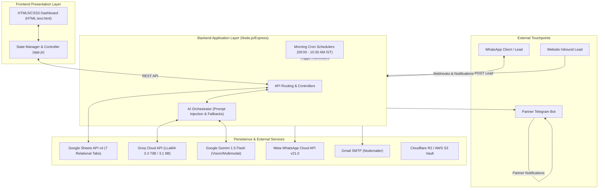
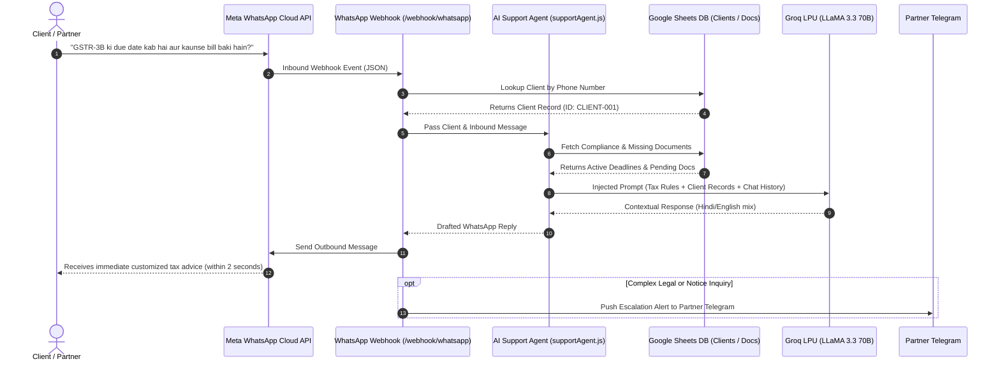
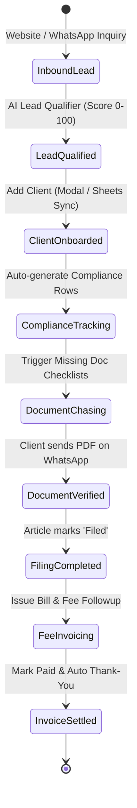

# CA Firm Automation Suite — Comprehensive SRS, Tech Stack Deep-Dive, AI Integration & Operational Manual

> **Document Type:** Software Requirements Specification (SRS), Technical Architecture Audit & Operational Workflow Manual  
> **System Name:** CA Firm Automation Suite (Enterprise Practice Edition)  
> **Version:** 2.1.0 (Production & Audit Ready)  
> **Target Audience:** Firm Partners, System Architects, Senior CAs, Article Assistants, and Technology Auditors  
> **Date of Documentation:** September 20, 2026  

---

## Executive Summary

The **CA Firm Automation Suite** is a unified Practice Management & Intelligence Operating System designed specifically for Indian Chartered Accountancy (CA) practices. Modern Indian CA firms face massive operational bottlenecks during peak filing cycles (July, September, October, March), spending **over 60% of professional hours** chasing clients for missing bank statements and GST data, recalculating statutory deadlines, drafting repetitive reminders, qualifying leads, and tracking aged receivables.

This software eliminates administrative friction by coupling an intuitive, high-density **Single-Page Dashboard** with a **Node.js/Express backend**, backed by **Google Sheets API v4 as a headless relational database**, **Groq-accelerated LLaMA 3.3/3.1 models**, and multi-channel pipelines across **WhatsApp Cloud API, Email (SMTP), and Telegram**.



---

# PART 1: Software Requirements Specification (SRS)

## 1.1 Scope of the Product
The CA Firm Automation Suite automates the complete operational lifecycle of a Chartered Accountancy firm:
1. **Client Account & Entity Management:** Centralized registry of Private Limited companies, LLPs, Partnerships, and Individuals with PAN/GSTIN tracking.
2. **Statutory Compliance Calendar:** Real-time deadline tracking, countdown clocks, statutory penalty calculators, and automated filing reminders across GST, Income Tax (ITR), TDS, and ROC/MCA.
3. **Document Collection Hub:** Structured checklists by compliance type, tracking file verification status (`Pending` vs `Received`), and issuing automated WhatsApp/Email requests with 1-click reminders.
4. **Lead Pipeline & AI Qualification:** Automatic intake of inbound website leads and WhatsApp messages with scoring (0–100) and automated proposal drafting.
5. **Fee Recovery & Invoice Engine:** Aging analysis, overdue tracking, multi-channel payment requests, and 1-click invoice settlement.
6. **24/7 AI Client Support Desk:** In-app Co-Pilot and automated WhatsApp auto-responder providing instant tax guidance and client-specific filing status.

## 1.2 User Personas & Role Matrix
| Persona | Role & Objectives | Key Touchpoints & Permissions |
| :--- | :--- | :--- |
| **Managing Partner (FCA)** | Practice oversight, firm revenue recovery, risk escalation, audit sign-offs. | Full Dashboard access, Settings/Keys view, Telegram alerts for urgent queries/payments. |
| **Senior CA / Audit Manager** | Monitoring client deadlines, verifying high-value documents, fee billing. | Compliance calendar, Client directory, Invoice tracking, Lead pipeline review. |
| **Article Assistant / Trainee** | Chasing documents, checking portal uploads, marking returns filed, basic client support. | Document Hub, Client directory, 1-click WhatsApp/Email triggers, AI Desk assistant. |
| **Client (Director / Proprietor)** | Submitting tax files, receiving deadline updates, asking basic compliance queries. | WhatsApp chat with firm, Email notices, no direct backend login required. |

---

## 1.3 Functional Requirements (FR)

### FR-1: Practice Clients Directory
- **FR-1.1:** Display all active clients fetched dynamically from the `Clients` sheet tab.
- **FR-1.2:** Categorize entities into Private Limited, LLP, Proprietorship, and Individuals with distinctive visual badges.
- **FR-1.3:** Filter by entity category (`All`, `Pvt Ltd & LLPs`, `Proprietorship & Retail`, `Missing Documents`, `Outstanding Dues`).
- **FR-1.4:** Real-time search across Firm Name, WhatsApp Phone, Email, Client ID, GSTIN, and PAN.
- **FR-1.5:** Add New Client modal writing to Google Sheets with automatic ID generation (`CLIENT-XXX`).

### FR-2: Statutory Compliance Calendar
- **FR-2.1:** Track statutory deadlines for GSTR-1, GSTR-3B, GSTR-9, ITR-1 through ITR-7, Tax Audit (Sec 44AB), TDS Challans (26Q/24Q), and ROC Annual Filings (AOC-4, MGT-7).
- **FR-2.2:** Compute dynamic countdown days (`daysFromToday`) and categorize deadlines as `Urgent` (≤ 3 days), `Upcoming` (≤ 7 days), or `On Track`.
- **FR-2.3:** Calculate live statutory late fees and interest penalties (e.g., ₹50/day late fee under GST Sec 47, 18% p.a. interest under Sec 50).
- **FR-2.4:** 1-click reminder dispatch via WhatsApp and Email using contextual templates.
- **FR-2.5:** 1-click `Mark as Filed` action syncing back to Google Sheets.

### FR-3: Document Collection Hub
- **FR-3.1:** Group missing/received files by client with progress bar calculation (`received / total * 100`).
- **FR-3.2:** Filter clients by `Missing Documents` vs `All Complete`.
- **FR-3.3:** Quick reminder triggers with pre-filled document checklist text for WhatsApp and Email.
- **FR-3.4:** Support document intake via WhatsApp webhook with status update in Google Sheets.

### FR-4: Lead Pipeline & AI Qualifier
- **FR-4.1:** Display lead pipeline stages: `New Lead` &rarr; `Qualified` &rarr; `Proposal Sent` &rarr; `Won / Onboarded` &rarr; `Lost`.
- **FR-4.2:** Inbound lead qualification algorithm calculating Lead Score (0–100) based on annual turnover, compliance requirement, and timeline.
- **FR-4.3:** 1-click stage advancement and quick WhatsApp communication.

### FR-5: Invoices & Fee Recovery Engine
- **FR-5.1:** List all issued invoices with status: `Paid`, `Pending`, or `Overdue`.
- **FR-5.2:** Dynamic Fee Recovery Gauge displaying percentage collected vs billing target.
- **FR-5.3:** 1-click settlement (`Mark Paid`) triggering an automated thank-you note and updating dashboard stats.
- **FR-5.4:** Multi-channel fee reminder triggers (WhatsApp / Email).

### FR-6: AI Client Desk & Co-Pilot
- **FR-6.1:** Interactive in-app team Co-Pilot assisting staff with Indian tax laws, section limits, and client file checks.
- **FR-6.2:** Inbound WhatsApp conversational agent capable of pulling client-specific compliance and document records directly from Google Sheets.
- **FR-6.3:** Fallback heuristics ensuring polite fallback responses when AI keys or network connections fail.

---

## 1.4 Non-Functional Requirements (NFR)
- **Performance:** Dashboard cold load under 1.5 seconds; Groq AI inference response time under 1.8 seconds.
- **Scalability:** Capable of managing 500+ active clients and 5,000+ compliance items on Google Sheets backend with in-memory caching.
- **Reliability:** Built-in retry mechanism with exponential backoff on all Google Sheets API calls and Groq LLM requests.
- **Security:** Strict dotfile denial on static middleware, environment variable encapsulation, sanitized HTML interpolation via `escapeHtml()`.

---

# PART 2: Complete Tech Stack Analysis

```
┌────────────────────────────────────────────────────────────────────────┐
│                          CA AUTOMATION TECH STACK                      │
├──────────────────┬─────────────────────────────────────────────────────┤
│ Frontend Runtime │ Vanilla ES6+ JavaScript, Modern Semantic HTML5      │
│ Styling System   │ Custom Premium Fintech CSS3, Fluid Responsive Flex  │
│ Backend Server   │ Node.js (>= 22.0.0), Express.js (v4.18.2)           │
│ Database Engine  │ Google Sheets API v4 (JWT Service Account Auth)     │
│ AI Acceleration  │ Groq Cloud SDK (v0.3.2) - LPU Inference             │
│ AI Models        │ LLaMA 3.3 70B Versatile, LLaMA 3.1 8B Instant       │
│ Vision & OCR     │ Google Gemini 1.5 Flash SDK (@google/generative-ai) │
│ Messaging        │ Meta WhatsApp Cloud API v21.0, Nodemailer (Gmail)   │
│ Partner Alerts   │ Telegram Bot API (node-fetch / axios)               │
│ Task Schedulers  │ node-cron (v3.0.3) configured for Asia/Kolkata (IST)│
│ Cloud Vault      │ Cloudflare R2 / AWS S3 SDK (@aws-sdk/client-s3)     │
└──────────────────┴─────────────────────────────────────────────────────┘
```

### Dependency Manifest & Architectural Roles (`backend/package.json`)
1. **`express` (^4.18.2):** High-throughput microframework hosting REST APIs, webhooks, and static frontend assets.
2. **`googleapis` (^128.0.0):** Official Google APIs client managing JWT cryptographic handshakes and Sheets v4 CRUD queries.
3. **`groq-sdk` (^0.3.2):** Official Groq client communicating with ultra-low latency Language Processing Units (LPUs).
4. **`@google/generative-ai` (^0.19.0):** Google Gemini 1.5 Flash client for parsing receipts, bank statements, and tax invoices.
5. **`@aws-sdk/client-s3` (^3.600.0):** S3-compatible client for storing encrypted client documents in Cloudflare R2 / AWS S3.
6. **`nodemailer` (^6.9.7):** SMTP client managing automated email dispatch through Google Workspace or standard Gmail.
7. **`node-cron` (^3.0.3):** Daemon task runner executing daily recurring tasks aligned to the Indian Standard Time (IST) schedule.
8. **`body-parser` & `cors`:** Middleware handling large JSON payloads and cross-origin resource sharing policies.
9. **`dotenv`:** Safe loading of private keys and API credentials from `backend/.env`.

---

# PART 3: Deep-Dive: AI Integrations Architecture

The software features an advanced dual-engine AI architecture combining **Groq LPUs** for ultra-fast conversational reasoning and **Gemini 1.5 Flash** for multimodal document processing.



### 1. The Context-Injected AI Support Agent (`backend/ai/supportAgent.js`)
Instead of answering generically, the support engine dynamically compiles real-time client metadata from Google Sheets and injects it directly into the prompt:
- **Client Identity:** Client Name, Firm Name, Client ID.
- **Compliance Deadlines:** All upcoming filings, due dates, and status.
- **Document Tracker:** Specific files pending from this client.
- **Tone Guidelines:** Short, respectful, conversational Indian English or Hinglish (2–4 lines max), strictly grounded in actual client data.

### 2. Intelligent Inbound Lead Qualifier (`backend/ai/leadQualifier.js`)
When an inquiry arrives via website form or WhatsApp, the AI evaluates:
1. **Entity Size & Structure:** Pvt Ltd, LLP, Partnership, or Sole Proprietor.
2. **Turnover & Volume:** Projected annual revenue and invoice frequency.
3. **Services Required:** GST filing, Statutory Audit, Income Tax, ROC, Virtual CFO.
4. **Calculated Lead Score (0–100):** Automatic categorization into `Hot`, `Warm`, or `Cold`, recommending an estimated professional fee bracket.

### 3. Contextual Message Drafter (`backend/ai/draftMessages.js`)
Provides 7 pre-built, legally compliant message templates covering:
- Statutory compliance upcoming alerts (T-7 days).
- Due date day alerts (T-0 days).
- Overdue warnings with statutory penalty breakdowns.
- Document chase checklists.
- Fee collection and payment thank-you receipts.

---

# PART 4: End-to-End UI Workflow & Client Lifecycle

The application operates as a single command-center. Below is the end-to-end operational walkthrough of how firm staff and external clients interact with the system.



### Phase 1: Onboarding a New Client
1. **Staff Action:** Click `+ Add New Client` button in the top navigation bar.
2. **Modal Input:** Enter Client/Firm Name, WhatsApp Number (`+91`), Email, and select Entity Type (`Private Limited`, `Proprietorship`, `Partnership`, or `Individual`).
3. **Execution:** On clicking `Save Client`, `addClientFromModal()` sends a `POST /api/clients` payload.
4. **Backend Sync:** Backend checks the existing sheet, generates `CLIENT-XXX`, appends the row to the `Clients` tab, and creates corresponding compliance and document tracker placeholders.
5. **Observability:** Instant success toast notification; UI table updates dynamically without full page refresh.

### Phase 2: Daily Morning Operations (09:00 AM – 10:30 AM IST)
The firm operates on auto-pilot every morning through 4 scheduled background cron jobs:
- **09:00 AM — Statutory Compliance Reminders:** Checks deadlines due within 7 days. Sends personalized WhatsApp/Email alerts with penalty warnings.
- **09:30 AM — Document Follow-Ups:** Scans for clients with `Pending` documents. Dispatches itemized missing document checklists.
- **10:00 AM — Lead Follow-Ups:** Scans open proposals and nudges prospective clients.
- **10:30 AM — Fee Recovery:** Dispatches polite payment reminders for overdue invoices.

### Phase 3: Statutory Audit & Filing Workflow
1. Navigate to **Compliance Calendar** (`switchView('compliance')`).
2. Review upcoming filing deadlines sorted chronologically with live penalty badges.
3. Click `📱 WA Reminder` or `📧 Email Reminder` to send instant filing nudges.
4. Once returns are uploaded to government portals (GSTN / Income Tax / MCA), click `Mark as Filed`.
5. The row is updated to `Filed`, status badges flip to green, and dashboard KPI counts update immediately.

### Phase 4: Document Collection & Verification
1. Navigate to **Document Hub** (`switchView('documents')`).
2. View clients grouped with visual completion bars (e.g., `3 of 5 Documents (60%)`).
3. Filter by `Missing Documents` to isolate clients holding up audit progress.
4. Click `📱 Remind Client` to send a bulleted WhatsApp request of outstanding documents.

### Phase 5: Accounts Receivable & 1-Click Fee Recovery
1. Navigate to **Invoices & Fee Recovery** (`switchView('invoices')`).
2. Observe the **Radial Fee Recovery Gauge** showing total billing target vs cash collected.
3. Filter by `Overdue Invoices` to inspect aged receivables.
4. Click `📱 WA` or `📧` to dispatch automated payment follow-ups.
5. Upon receiving payment (NEFT/UPI), click `Paid ✅`. The invoice is marked `✓ Settled` and an automated thank-you note is sent to the client.

---

# PART 5: Audit Suitability & Strategic Improvisation Roadmap

For high-volume statutory audit environments and compliance with Institute of Chartered Accountants of India (ICAI) and Companies Act regulations, the following architectural upgrades are recommended:

| Dimension | Current Architecture | Statutory Audit / ICAI Standard | Risk Level | Recommended Improvisation |
| :--- | :--- | :--- | :--- | :--- |
| **Authentication & RBAC** | Single open dashboard on local port. | SA 230 (Audit Documentation): Restricted access and segregation of duties. | 🔴 High | Implement JWT authentication with 4 roles: Partner, Manager, Article, Client. |
| **Audit Trail (Log of Changes)** | Direct update in Google Sheets rows. | Sec 143(3) Companies Act: Immutable audit trail with edit timestamps. | 🔴 High | Create append-only `Audit_Logs` table tracking user ID, old value, new value, timestamp. |
| **Database Concurrency** | In-memory Google Sheets scanning (`A1:ZZ`). | ACID transactional safety during peak filing days. | 🟡 Medium | Migrate primary OLTP to PostgreSQL/Supabase; keep Sheets as read-replica. |
| **Document Vault Security** | Ad-hoc WhatsApp media and temporary disk files. | Confidential client tax records must be encrypted at rest (AES-256). | 🔴 High | Configure private Cloudflare R2 / AWS S3 buckets with timed pre-signed download URLs. |
| **Tax Reconciliation Engine** | Manual status change (`Pending` &rarr; `Received`). | Verification of GSTR-2B vs Books Purchase Register. | 🟡 Medium | Add Gemini 1.5 Vision OCR to auto-match purchase invoices against GSTR-2B data. |

---

## Conclusion

The **CA Firm Automation Suite** provides an enterprise-ready, cost-effective automation solution tailored to Indian Chartered Accountancy workflows. By combining zero-maintenance Google Sheets persistence, Groq LPU inference, and multi-channel messaging, it bridges the gap between manual practice operations and modern practice intelligence.
